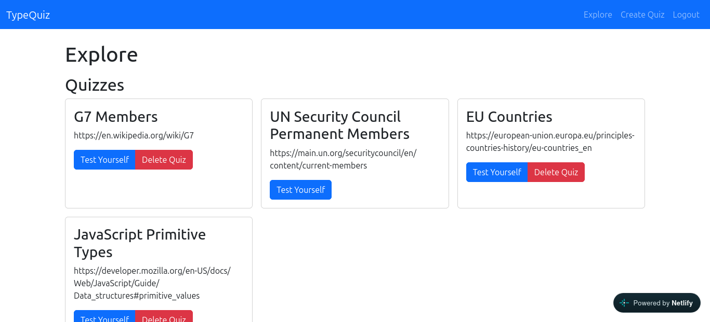

# TypeQuiz

A [type-in-the-box-style](https://www.jetpunk.com/quizzes/how-many-countries-can-you-name) platform that allows users to create their own quizzes.

**[Live demo](https://typeinquiz.netlify.app/)**



## Features
- Test yourself on quizzes consisting of a list of members of a set (e.g. countries, monarchs, etc.) which users are prompted to guess
- Create an account to create and manage one's quizzes
- Tracks how many answers you've got and reveals the one's you didn't if you give up

## Tech stack
React, TypeScript, Node.js, Express.js, MongoDB

## Running locally
```bash
git clone https://github.com/tomjbradley/typequiz.git
cd typequiz
npm install --prefix client
npm install --prefix server
npm start --prefix server & npm run dev --prefix client
```
The server directory requires a .env file with suitable variables named `MONGODB_URI` and `JWT_SECRET`.

## What I learned
How to manage user data in a multitenancy application and how to securely type variables representing both server generated models and their representation in client-side state.
